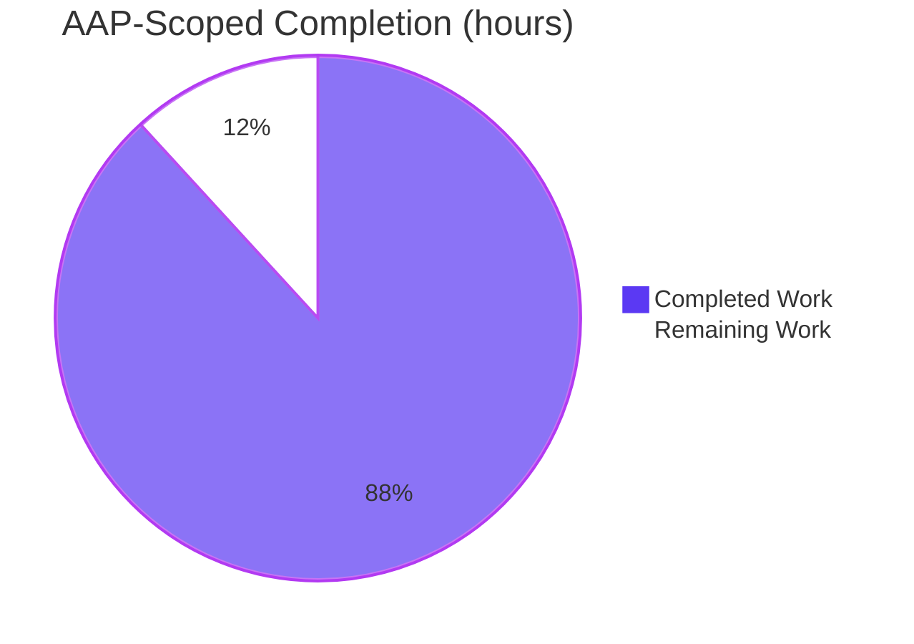
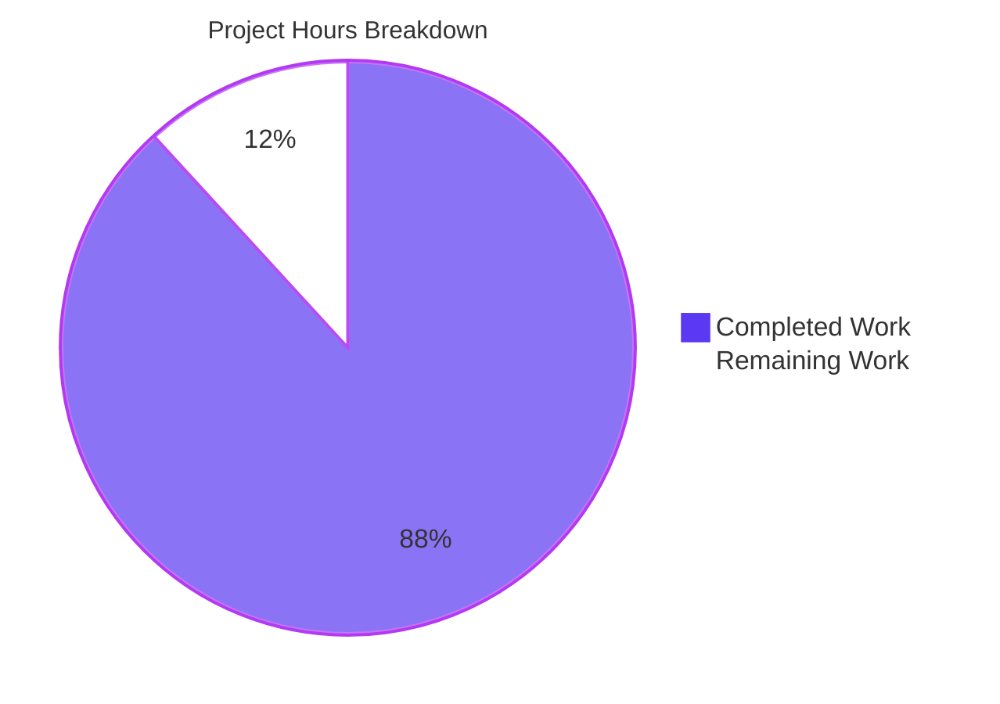

# 1. Executive Summary

## 1.1 Project Overview

A zero-dependency Node.js HTTP server in one readable file: it answers `GET /hello` with a fixed plain-text body, answers every other request with `404 Not Found`, logs each request, takes its port from `PORT`, and starts and stops cleanly from a terminal. It teaches framework-free HTTP handling — no framework, package, build step or outbound call — to developers learning Node's `http` module and to instructors. Scope: three root files, a loopback listener and a seven-line console contract.

## 1.2 Completion Status

**88% complete** — 56.0 hours delivered of 63.5 hours scoped by the Agent Action Plan (AAP) and the path to production. Dark Blue = completed (#5B39F3), White = remaining (#FFFFFF).



| Metric | Hours |
|---|---|
| Total Hours | 63.5 |
| Completed Hours (Baseline: Human with agentic-assist) | 56.0 |
| Remaining Hours | 7.5 |

Calculation: 56.0 ÷ 63.5 × 100 = 88%, measured over the 17 AAP requirements (F1–F11, N1–N6) plus three path-to-production activities: engine-floor verification, lockfile reconciliation and clean-machine documentation acceptance.

## 1.3 Key Accomplishments

- `GET /hello` returns `200`, `Content-Type: text/plain`, `Content-Length: 11`, body `Hello world`.
- Every other request returns `404` with a 9-byte `Not Found`: other methods, paths, case variants, trailing slash, `OPTIONS *`, body-less `HEAD`.
- Matching rule: query ignored (`/hello?x=1` → 200); trailing slash and case significant.
- One log line per handled request, before routing, with ISO-8601 timestamp, method and verbatim target.
- Ports: default 3000, override, trimming, digits-only, 1024–65535, empty rejected, privileged refused.
- Lifecycle: startup line only after bind, `EADDRINUSE` once with exit 1, SIGINT exit 0 with the port released.
- Failure discipline: a rejected URL yields a detail-free `500`, the cause on stderr only, and the server keeps serving.
- Zero footprint: one `require('http')`, seven manifest fields, no dependency block, no runner, no build step.

## 1.4 Critical Unresolved Issues

**5 of 20 scoped items remain open** — 2 of the 17 AAP requirements are partially open (N3, N5) and all 3 path-to-production activities are outstanding.

| Issue | Impact | Owner | ETA |
|---|---|---|---|
| N3 acceptance value: a cold-start reading exceeds the 10,240 KB memory bar (measured 11,916 KB) although no request data is retained | A future acceptance run can report a false failure; no runtime impact | QA lead | 1 h |
| N5 comment inventory: 10 inline-comment blocks (21 lines) against the 5 points the plan enumerates | Mechanical style check reports a delta; no behavioural impact | Code owner | 1 h |
| Declared `engines.node ">=18.0.0"` is unverified on 18.0.x/18.1.x, where neither socket-release method exists | A shutdown can wait unbounded on those releases against a client that never completes a request head | Backend engineer | 3 h |
| Tracked `package-lock.json` still carries the pre-existing `hello_world` identity with no packages | `npm ci` cannot succeed; `node server.js` and `npm start` are unaffected | Release engineer | 1 h |
| Documentation accepted from the implementation side only; no independent clean-machine walkthrough | A reader on a fresh host may hit an undocumented step | Technical writer | 1.5 h |

## 1.5 Access Issues

No access issues identified. The server needs no credential, account, key, database or network access: it binds loopback and reads one variable, `PORT`. A Node.js runtime and `curl` are all it takes.

## 1.6 Recommended Next Steps

1. **[High]** Verify the declared Node 18.0.0 floor on an 18.0.x runtime, then raise the floor or document the wait.
2. **[Medium]** Reconcile the tracked lockfile so `npm ci` succeeds in any pipeline.
3. **[Medium]** Record the warmed-process protocol for the memory acceptance measurement.
4. **[Medium]** Have a reader who has not seen `server.js` execute `README.md` on a clean host.
5. **[Low]** Decide whether the enumerated comment list is closed, and settle the extra explanations.

# 2. Project Hours Breakdown

## 2.1 Completed Work Detail

| Component | Hours | Description |
|---|---|---|
| Manifest and engine floor (F10, N6) | 2.0 | `package.json` with exactly seven fields — name, version, description, main, `scripts.start`, `engines.node`, keywords — and no dependency block of any kind. |
| Port configuration and validation (F3, F6) | 5.0 | `resolvePort` in `server.js:17-43`: default when unset, trim, digits-only test before `Number()`, 1024–65535 range, control-character escaping, one-line rejection with exit 1 before any listener exists, loopback bind. |
| Routing and the two response contracts (F1, F2, §0.6.3 matching rule) | 8.0 | Constants block, frozen `ROUTES` table, `matchRoute`, `handleHello`, `handleNotFound`, and URL-based dispatch that ignores the query string while keeping path and method exact. |
| Response funnel and failure path (F9, §0.6.3 headers) | 7.0 | Single `writeHead`/`end` funnel with byte-exact `Content-Length` and a duplicate-write guard; the three-way catch that distinguishes an ended response, a begun one and an unanswered one. |
| Request logging (F5) | 2.0 | `logRequest` as the first statement of the pipeline, emitting ISO-8601 timestamp, method and the request target verbatim, 404s included. |
| Server lifecycle, signals and exit statuses (F4, F7, F8, N4) | 10.0 | Startup line from the listen callback, `'error'` listener registered before `listen`, `EADDRINUSE` branch, shutdown print/flag/close sequence, guarded idle-connection release, bounded grace window, exit-status preservation. |
| Performance and memory design (N1, N2, N3) | 4.0 | I/O-free synchronous handlers, constant-time frozen-table lookup, no per-request value retained at module scope, and the measurement work behind the acceptance discussion. |
| Documentation (F11) | 8.0 | `README.md`: the two pre-existing lines preserved at the top, eight sections, twelve runnable command blocks, seven console-message bullets, expected-output blocks transcribed from real responses, port rules and shutdown steps. |
| Verification campaign (§0.10.1 gate set, §0.13.2/§0.13.3 static and security checks) | 10.0 | Functional, performance, configuration and documentation gates; static quality and security sweeps; entry-point parity; lifecycle and failure-path probes. |
| **Total** | **56.0** | |

## 2.2 Remaining Work Detail

| Category | Hours | Priority |
|---|---|---|
| Engine-floor verification on Node 18.0.x — exercise the contracts and the shutdown paths where `closeIdleConnections`/`closeAllConnections` may be absent, then raise the floor or document the degraded wait | 3.0 | High |
| Lockfile reconciliation — regenerate or remove the tracked `package-lock.json` so `npm ci` agrees with the manifest | 1.0 | Medium |
| Memory acceptance protocol — record the warmed-process sequencing (after the functional, latency and concurrency checks on the same process) as the measurement of record | 1.0 | Medium |
| Clean-machine documentation acceptance — a reader who has not seen the code executes `README.md` end to end and every documented command and output is confirmed | 1.5 | Medium |
| Comment-inventory decision — confirm whether the enumerated list is closed; if so, fold the extra explanations into the code and re-run the comment check | 1.0 | Low |
| **Total** | **7.5** | |

Each row traces to an AAP requirement or a path-to-production need: the first two to the declared support range and to release hygiene, the third to N3's acceptance value, the fourth to F11 acceptance, and the fifth to N5.

## 2.3 Hours Reconciliation

| Check | Value |
|---|---|
| Completed work (2.1 total) | 56.0 h |
| Remaining work (2.2 total) | 7.5 h |
| Total project hours (1.2) | 63.5 h |
| Completed + Remaining = Total | 56.0 + 7.5 = 63.5 ✅ |
| Completion percentage (1.2, 7, 8) | 56.0 ÷ 63.5 = 88% ✅ |
| Remaining hours (1.2, 2.2, 7) | 7.5 h in all three ✅ |

Estimation basis: hours are attributed per delivered component against the AAP requirement it satisfies, with verification effort counted as engineering time. Remaining hours use the same per-item basis at the granularity of the work a human must still do, not a re-estimate of the whole component. Confidence is high for the manifest, documentation and lockfile items; medium for the engine-floor verification, where the work depends on what a Node 18.0.x runtime actually reports.

# 3. Test Results

The project ships no application test suite: the deliverable is three files and the zero-dependency mandate forbids adding a runner, so the evidence is the documented acceptance command set executed against the live server. The table below is one complete execution of that set plus the static and security checks, run on Node.js v22.23.5: **117 checks, 117 passed, 0 failed**, about 104 seconds wall time including 1,500 load requests.

| Area / Category | Framework | Tests | Passed | Failed | Coverage | What This Proves |
|---|---|---|---|---|---|---|
| HTTP contract and routing | `curl` assertions over HTTP/1.1 | 26 | 26 | 0 | Not applicable — no instrument | Both contracted responses and the matching rule hold byte for byte: status, `Content-Type`, `Content-Length` 11/9 and bodies of exactly 11 and 9 bytes. |
| Startup and stream discipline | `node` process capture | 3 | 3 | 0 | Not applicable — no instrument | The startup line is emitted once, only after a successful bind, and a healthy run writes nothing to stderr. |
| Request logging and the failure path | raw sockets + log assertions | 12 | 12 | 0 | Not applicable — no instrument | Exactly one log line per handled request before routing, 404s included; parser-rejected requests add none; a handler failure answers a detail-free `500` and the process keeps serving. |
| Port configuration and bind failure | process matrix (10 values) + `lsof` | 39 | 39 | 0 | Not applicable — no instrument | Default, override, trim, digits-only, 1024–65535 range, empty-value rejection, privileged refusal, control-character escaping, and `EADDRINUSE` reported once with exit 1. |
| Lifecycle, signals and exit statuses | `kill`/`wait` status capture | 9 | 9 | 0 | Not applicable — no instrument | SIGINT prints the shutdown line last, exits 0 and releases the port; repeated SIGINT is absorbed to one line; SIGTERM stays untrapped at 143. |
| Performance and memory | `curl` timing, `xargs -P`, `ps` RSS | 3 | 3 | 0 | Not applicable — no instrument | Latency median 0.000472 s against a 0.010 s bar; 100 concurrent requests all `200`; no per-request retention (warmed RSS delta 1,860 KB against a 10,240 KB bar). |
| Static quality, security and manifest | `node --check`, `node` assertions, greps | 17 | 17 | 0 | Not applicable — no instrument | One built-in import, seven manifest fields with no dependency block, three `console.log` and three `console.error` sites, no forbidden API, no placeholder, no credential. |
| Entry points and documentation surface | `npm`/`node` boot + fence parsing | 8 | 8 | 0 | Not applicable — no instrument | `npm start` and `node .` both boot and serve the contract; the README keeps its two original lines, its eight sections in order, and all twelve command blocks parse. |
| **Total** | | **117** | **117** | **0** | | |

## Not Covered

- **Node 18.0.0 / 18.1.0 shutdown behaviour.** On those releases neither `closeIdleConnections` nor `closeAllConnections` exists, so the `typeof`-guarded branches are not reachable on the runtime in use. A human should run the SIGINT scenarios on an actual 18.0.x runtime before relying on the declared engine floor.
- **The two begun-response branches of the failure path.** `sendText`'s `writableEnded` return (`server.js:50-52`) and the catch's `headersSent` teardown (`server.js:94-97`) cannot be reached by any contracted request, because both handlers are synchronous and total. They were exercised only against the delivered functions with injected throws. A human adding a handler that performs I/O or writes before throwing should cover them.
- **The generic non-`EADDRINUSE` bind message** (`server.js:111`). With the host fixed to loopback and every port below 1024 rejected before a bind is attempted, no configuration reaches it; it is documented from the code.
- **Default-port startup on the real port 3000.** In the acceptance environment that port is held by other processes, so the default was confirmed by reading `DEFAULT_PORT = 3000` and by exercising the `PORT` override; a clean host should confirm the default once.
- **README aids that depend on the reader's machine** — the `pgrep` fallback for a lost process id and the "install curl if missing" remedy — are documented but were not exercised here.
- **Coverage percentage.** No coverage instrument exists and none may be added, so no coverage figure is reported; the command set above is the substitute.
- **No user interface.** The product is a headless server, so there is no screen, browser console or performance audit to run.

Before release a human should: run the commands in `README.md` on a clean host, repeat the SIGINT scenarios on Node 18.0.x, and confirm that `npm ci` behaves once the lockfile is reconciled.

# 4. Runtime Validation & UI Verification

Every flow below was driven against a live process on loopback, with stdout and stderr captured separately.

- ✅ **Startup** — `node server.js`, `npm start` and `node .` each bind and print `Server listening on port <PORT>` once, with nothing on stderr; a failed bind leaves stdout empty.
- ✅ **`GET /hello`** — `200`, `Content-Type: text/plain`, `Content-Length: 11`, body `Hello world`, no chunked framing.
- ✅ **Catch-all and matching rules** — `/invalid`, `/hello/`, `/Hello`, `POST`/`PUT`/`PATCH`/`DELETE`/`OPTIONS` `/hello`, and `OPTIONS *` all return `404` with a 9-byte `Not Found`; `HEAD /hello` returns `404` headers with no body; `/hello?x=1` returns `200`.
- ✅ **Request logging** — one line per handled request, before routing, in `2026-11-23T14:08:41.259Z GET /hello` form, with the query string preserved verbatim; the count matches the requests issued.
- ✅ **Port configuration** — override and trimmed-value instances served while the original instance kept serving; ten rejected or privileged values each exit 1 with one stderr line and empty stdout.
- ✅ **Bind failure** — a second instance on a held port prints `Failed to start server: port <PORT> is already in use (EADDRINUSE).` once and exits 1.
- ✅ **SIGINT shutdown** — `Server shutting down` as the last stdout line, exit status 0, port released and immediately rebindable, including with idle keep-alive sockets, half-sent request heads and repeated signals.
- ✅ **Failure path** — a request target the URL parser rejects answers `500` with `Content-Length: 21` and no detail, logs one stack-free stderr line, and the next request is served normally.
- ⚠ **Node 18.0.0 / 18.1.0 runtime** — never exercised. The socket-release calls are `typeof`-guarded; on releases without them a shutdown against a client that never completes a request head waits for Node's own timeout instead of the one-second bound observed on the runtime in use.
- ⚠ **The begun-response failure branches** — never exercised through HTTP, because no contracted request can reach them; only injected throws against the delivered functions exercised them.

**Never exercised at runtime:** the Node 18.0.0/18.1.0 floor described above; the generic non-`EADDRINUSE` bind message, which no configuration can produce; and the README's `pgrep` fallback and curl-install remedies, which describe the reader's machine rather than this one.

**External integrations:** none exist. The product makes no outbound connection, reads no remote service and holds no credentials; its only boundaries are HTTP/1.1 on `127.0.0.1` and line-oriented console output, so there is no third-party integration to drive.

**User interface:** none exists. The deliverable is headless and returns `text/plain`, so no screen, browser console, network panel or performance audit applies; the operator-facing surface is the console contract verified above.

# 5. Compliance & Quality Review

## 5.1 Compliance Matrix

| Deliverable | Requirement | Status | Verified Evidence |
|---|---|---|---|
| `GET /hello` contract | F1, §0.6.3 row 1 | ✅ Pass | `server.js:9-11,54-59`; live `200` / `text/plain` / `Content-Length: 11` / 11-byte body |
| Catch-all and matching rule | F2, §0.6.3 rows 2 and matching rule | ✅ Pass | `server.js:62-68,76-84`; every non-matching method and path returns `404` with 9 bytes; query ignored, slash and case significant |
| Port configuration and validation | F3, F6, D9 loopback bind | ✅ Pass | `server.js:3,6,17-43,159,174`; ten rejected values exit 1 with one line; override and trim accepted; `127.0.0.1` only |
| Lifecycle and exit statuses | F4, F7, F8, N4 | ✅ Pass | `server.js:103-115,134-175`; startup only after bind, `EADDRINUSE` exit 1, SIGINT exit 0 with port released, failure status preserved through shutdown |
| Error disclosure | F9 | ✅ Pass | `server.js:85-100`; `500` with a constant body, detail on stderr only, no stack frame, process keeps serving |
| Manifest and dependency footprint | F10, N6 | ✅ Pass | `package.json:1-13`; seven fields, no dependency block, one built-in `require` |
| Documentation | F11, §0.12 C1 | ✅ Pass | `README.md`: two original lines preserved, eight sections in order, twelve command blocks parse, documented outputs reproduced |
| Performance and concurrency | N1, N2 | ✅ Pass | Median 0.000472 s against a 0.010 s bar; 100 concurrent requests all `200` |
| Memory stability | N3 | ⚠ Partial | No retention (warmed RSS delta 1,860 KB, plateau flat to 8,000 requests); the plan's literal cold-start bar is exceeded (11,916 KB) — see D7 |
| Readability and comment discipline | N5, §0.13.1 | ⚠ Partial | One responsibility per function, fixed file order, route table as data; 10 comment blocks (21 lines) against the 5 enumerated points — see D6 |
| Security constraints | §0.13.3, §0.13.4 | ✅ Pass | No `eval`/`new Function`/`vm`, no `fs`/`path`/`os`, no outbound client, no credential, loopback bind, no request data reflected |
| Scope discipline | §0.8.1, §0.8.2, §0.9.1 | ✅ Pass | Only the three named paths changed (415 insertions, 22 deletions over 8 commits); no test suite, CI, container, framework or extra signal handler |

## 5.2 AAP & Rule Divergences and Gaps

No user-specified Rules exist for this project — the plan records that none were provided — so every divergence below is from an AAP clause. Nine were identified; six are departures the plan's own requirements forced, one is a scope-sanctioned delivery form, and two remain open.

| # | What The AAP/Rule Required | What Was Delivered Instead | Why It Diverged | Impact | Remediation |
|---|---|---|---|---|---|
| D1 | §0.6.3: "`Content-Length`, `Date` and `Connection` are generated by Node from the body and the connection" | `Content-Length` set explicitly by the funnel (`server.js:54`) | The same section freezes the exact values 11 and 9, which cannot be produced if the header set is fixed before the body exists | None on the wire: both responses match the contract table | **Sanctioned** by the contract value it serves; if the plan is ever revised, its prose should say the application sets the header |
| D2 | §0.4.1 lists the runtime globals used as `process`, `console`, `URL`, `Date`, `Number`, `Error` | `Buffer` is also used (`server.js:54`) | It is the byte-exact way to measure an HTTP body length and needs no import | That enumeration is one entry short of the file | **Sanctioned**; note in the plan if revised |
| D3 | §0.3.5 signal rule 3 and §0.6.1's snippet terminate with `process.exit(0)` | Exit statuses are set with `process.exitCode` and the process drains naturally (`server.js:114,120-122,163`) | `process.exit()` can drop a queued pipe-backed write — measured at 65,536 of 300,001 bytes delivered | Exit statuses are unchanged (0/1/143) and every console line now survives redirection | **Sanctioned** by F8/N4's exit-status requirement |
| D4 | §0.3.5's shutdown sequence, §0.6.1's component table and §0.13.4's "exactly the two callbacks" | `SHUTDOWN_GRACE_MS`, `onShutdownComplete`, `onShutdownGraceExpired` and an unref'd one-second timer calling `closeAllConnections` (`server.js:7,117-156`) | `close()` keeps accepted connections and removes the header timeout, so a client that never completes a request head held CTRL+C open indefinitely | Shutdown is bounded at about one second for every client state; a future handler taking longer would be cut | **Sanctioned** by F8/N4; revisit the bound if a handler ever performs I/O |
| D5 | §0.3.5 row 4 echoes the rejected value "exactly as received" | Control characters are rendered as `\uXXXX` (`server.js:22-26`) | The same row also requires "one stderr line", which a value carrying a line break cannot satisfy; unescaped it forged log lines (CWE-117) | Every printable value stays byte-identical; control characters are visible and unambiguous | **Sanctioned** by that row's one-line property |
| D6 | §0.13.1 lists the comment points as "exactly these five" | Ten inline-comment blocks over 21 lines | The five additional blocks explain non-obvious Node behaviour — control-character escaping, the header-timeout interaction, the grace timer, the begun-response teardown and the guarded exit status — which the section's leading clause permits | The mechanical comment check reports ten blocks rather than five | **Needs a human decision** (1 h): accept the inventory or fold the explanations into the code |
| D7 | §0.10.1: RSS growth under 10,240 KB over 1,000 requests | 11,916 KB from a cold start; 1,860 KB on a warmed process | The figure measures the runtime's one-time cold-heap reservation: a server with no application code grows the same 11.3–11.5 MB, and nothing is retained per request | A future acceptance run reading a cold start reports a failure for a correct implementation | **Open** (1 h): record the warmed-process sequencing as the measurement of record |
| D8 | §0.7.2 labels `README.md` as a create | Delivered as an update that preserves the attachment's two lines at the top | §0.12 resolution C1 requires those lines be kept verbatim, and the documentation cannot go elsewhere | None; the file is additive (+228 lines, no deletions) | **Sanctioned** by C1 |
| D9 | No file outside the three deliverables is created, modified or deleted | The tracked `package-lock.json` keeps its pre-existing `hello_world` identity and empty package set | The plan's own scope rule forbids touching it, and nothing in the deliverable needs a lockfile | `npm ci` cannot succeed even though the manifest declares no dependencies | **Open** (1 h): regenerate or remove the lockfile |

**D3 — why the exit mechanism is `process.exitCode`.** The plan's snippets terminate with `process.exit(0)`. Node documents that `process.exit()` can discard pending writes to `process.stdout` and `process.stderr`, and a controlled test delivered 65,536 of 300,001 bytes through a pipe before the process left. Since the console contract is the product's only operator surface, the status is now set and the process allowed to drain: exit 1 on a rejected `PORT` and on a bind failure, exit 0 on a completed shutdown, 143 on `SIGTERM`, with every line arriving intact when output is piped. Nothing in the observable behaviour differs from the plan's intent (`server.js:114,120-122,163`).

**D4 — why the shutdown carries a grace bound.** The prescribed sequence calls `close()`, releases idle keep-alive sockets and waits for the `'close'` event. That event is withheld while any accepted connection remains open, and `close()` also removes the header timeout that would otherwise drop a client that never finishes sending its request line. Measured against the plan's sequence alone, pressing CTRL+C with one such socket open left the process serving indefinitely. The delivered form keeps the intent — in-flight requests finish, idle sockets go at once — and adds an unref'd one-second window after which anything still open is ended (`server.js:125-156`). Shutdown measured 6–8 ms with idle sockets and about 1,030 ms with a half-sent request head, exit 0 in every case.

**D6 — the comment inventory needs a decision.** `server.js` carries ten inline-comment blocks over 21 lines where the plan enumerates five points as the expected set. The five additional blocks explain the control-character escaper, the interaction between `close()` and the header timeout, the shutdown grace timer, the begun-response teardown and the guarded exit status — each a place where the code's correctness is not obvious from the statement itself. A maintainer should decide whether the enumerated list is closed. If it is, the explanations can be folded into the code or removed and the comment check re-run; nothing in the behaviour depends on the outcome (`server.js:22,92-93,118-119,126-128,151-153`).

**D7 — the memory acceptance value needs restating before a formal acceptance run.** The plan fixes RSS growth under 10,240 KB over the first 1,000 requests. Measured from a cold start on the shipped runtime, the server grows 11,916 KB (47,988 → 59,904 KB), and a control server containing no application code grows the same 11.3–11.5 MB, so the figure tracks the runtime's heap reservation rather than request handling. On the plan's own sequencing — the memory check after the functional, latency and concurrency checks on the same process — the delta is 1,860 KB and the plateau is flat to 8,000 requests. The substance of N3 holds; the number needs a recorded protocol (`server.js:13-15,45-47,70-100`).

**D9 — the stale lockfile blocks `npm ci`.** The repository's tracked `package-lock.json` predates this work: its root name is `hello_world`, it lists no packages, and it carries a licence field the manifest does not. The plan's scope rule keeps every file outside the three deliverables untouched, so it was left as found. Running the server is unaffected — `node server.js` and `npm start` need no install — but any pipeline that starts with `npm ci` fails against a manifest it cannot reconcile. Regenerating the lockfile from the manifest, or deleting it since nothing is installed, is a one-hour task for whoever owns releases.

# 6. Risk Assessment

| Risk | Category | Severity | Probability | Mitigation | Status |
|---|---|---|---|---|---|
| The manifest declares Node.js `>=18.0.0`, but on 18.0.x/18.1.x neither socket-release method exists, so a client that never completes a request head can hold a shutdown open instead of hitting the one-second bound | Technical | Medium | Medium | Both calls are `typeof`-guarded and the degradation is described in the README's shutdown section; run the scenarios on 18.0.x and then raise the floor or document the wait | Open — verification outstanding |
| `npm ci` cannot succeed because the tracked lockfile carries the pre-existing `hello_world` identity and no packages | Operational | Medium | High once CI is added | `node server.js` and `npm start` need no install; regenerate or remove the lockfile | Open — 1 h |
| A cold-start reading of the memory check overshoots the stated bar for an implementation that retains nothing, so an acceptance run can report a failure that is not there | Operational | Medium | Medium | Retention is proven on the warmed process (1,860 KB, flat plateau) and the protocol should be recorded with the bar | Open — 1 h |
| The two begun-response branches of the failure path are unreachable from any contracted request, so a future handler that performs I/O or writes before throwing would enter code no HTTP-level check has exercised | Technical | Medium | Low | Both branches are documented in the README's failure bullet and were exercised against the delivered functions with injected throws | Monitoring |
| The one-second shutdown window would truncate a handler that legitimately needs longer than that to finish | Technical | Low | Low | Both handlers are synchronous and I/O-free, so no contracted request is affected; the bound should be revisited if a handler gains I/O | Accepted |
| No application test suite or coverage instrument exists by design, so a future edit is guarded only by the documented command set | Technical | Medium | Medium | The README's testing section is the same command set the acceptance checks run, so a reader and a reviewer execute identical evidence | Accepted — by the zero-dependency mandate |
| The request target is logged verbatim as the logging requirement demands, so an absolute-form target carrying userinfo would appear in the operator's console | Security | Low | Low | The listener is loopback-only and the output is confined to the operator's terminal; the escaper used for the rejected port value would close it if the format is ever relaxed | Accepted |
| Plain HTTP, no authentication, no rate limiting, no TLS, loopback-only listener | Security / Operational | Low for the stated purpose, Medium if repurposed | Low | Appropriate for a local teaching artifact and documented as such; treat any network-facing use as a new project | Accepted |

**Integration risk: none exists.** The product holds no upstream service, database, message broker, third-party API or outbound socket, and no credential of any kind. Its only boundaries are HTTP/1.1 on `127.0.0.1` and line-oriented console output, both exercised above, so there is no unverified integration surface to carry as a risk.

# 7. Visual Project Status

Completion by hours: 56.0 delivered, 7.5 remaining, **88% complete**. Completed work is Dark Blue (#5B39F3), remaining work White (#FFFFFF).



## Remaining hours by category

| Category | Hours | Priority |
|---|---|---|
| Engine-floor verification (Node 18.0.x) | 3.0 | High |
| Clean-machine documentation acceptance | 1.5 | Medium |
| Lockfile reconciliation | 1.0 | Medium |
| Memory acceptance protocol | 1.0 | Medium |
| Comment-inventory decision | 1.0 | Low |
| **Total** | **7.5** | |

## Status by requirement group

| Group | Requirements | Delivered | Partially open |
|---|---|---|---|
| HTTP contract and routing | F1, F2 | 2 | 0 |
| Configuration and validation | F3, F6 | 2 | 0 |
| Lifecycle, signals and failure handling | F4, F5, F7, F8, F9 | 5 | 0 |
| Metadata and documentation | F10, F11 | 2 | 0 |
| Performance and concurrency | N1, N2 | 2 | 0 |
| Memory stability | N3 | 0 | 1 |
| Lifecycle cleanliness | N4 | 1 | 0 |
| Readability and teaching quality | N5 | 0 | 1 |
| Dependency footprint | N6 | 1 | 0 |
| **Total** | **17** | **15** | **2** |

# 8. Summary & Recommendations

**What was delivered and verified.** Three root files now constitute the whole product: `server.js` (177 lines, one executable script with thirteen named functions and a frozen route table), `package.json` (seven metadata fields and nothing else) and `README.md` (the two original lines plus eight documentation sections). The change is additive apart from the replaced stubs: 415 insertions and 22 deletions across eight commits. Everything the plan scopes is present and behaves as specified — the two response contracts down to the byte, the matching rule, the request log, the port matrix, the lifecycle and exit statuses, the failure discipline, and the metadata and documentation gates — with 117 of 117 acceptance checks passing on a live server.

**How complete it is.** 56.0 hours of the 63.5 hours scoped are delivered, **88% complete**. Fifteen of the seventeen requirements are fully met. The two that are not are narrow: N3's numeric acceptance value measures the runtime's cold-heap reservation rather than retention, and N5's comment inventory runs five blocks past the list the plan enumerates. Neither affects a single response, log line or exit status. The three path-to-production activities — proving the declared Node 18 engine floor, reconciling the lockfile, and an independent documentation walkthrough — are the only work between this state and a release.

**Critical path to production.** In order: run the server and its shutdown paths on Node 18.0.x and settle the engine floor in `package.json`; regenerate or remove the tracked lockfile so `npm ci` succeeds; record the warmed-process protocol for the memory acceptance check; then have someone who has not read the source execute `README.md` on a clean host. The comment decision is a code-owner judgement that can land with any of these. Together they are seven and a half hours, none of them blocking a reader from running the server today.

**Success metrics.** Both contracted responses match their specified status, header set and body length on every run; latency sits 21× under the ten-millisecond bar (median 0.000472 s); 100 concurrent requests all answer `200`; memory shows no per-request retention across 8,000 requests; every rejected port value and every bind failure exits 1 with exactly one actionable line; every clean shutdown exits 0 with the port released and the shutdown line last; and the dependency set is empty, with a single built-in import.

**Production readiness.** For its stated purpose — a single-process, loopback-only teaching reference run from a terminal — the code is ready, with the engine-floor verification and lockfile reconciliation as the two items to clear before it is tagged. It is not a deployment template: no TLS, no authentication, no rate limiting, no persistence and no clustering exist, deliberately. Extending it toward a network-facing service is a new design exercise, not a configuration change.

# 9. Development Guide

Every command below was executed from the repository root and the outputs shown are the ones observed. Nothing needs to be installed beyond a Node.js runtime.

## 9.1 System prerequisites

- **Node.js 18.0.0 or newer** — `server.js` uses only APIs present in 18.0.0, with the two socket-release calls feature-guarded. Verified on v22.23.5.
- **npm** (bundled with Node.js) — only needed for the `npm start` entry point. Verified on 11.21.0.
- **curl** — needed by the verification commands in this guide and in `README.md`, not by the server itself. Verified on 8.18.0.
- No compiler, bundler, database, container runtime or environment file is used.

```bash
node --version     # v22.23.5  (must be >= 18.0.0)
npm --version      # 11.21.0
curl --version | head -1   # curl 8.18.0
```

## 9.2 Environment setup

There is no virtual environment and no configuration file. The only setting is the `PORT` environment variable, read once at startup. When it is unset the server binds 3000; when it is set it must be a whole number from 1024 to 65535, and an empty value is rejected rather than treated as absent.

```bash
node server.js              # binds 3000
PORT=4000 node server.js    # binds 4000
```

## 9.3 Dependency installation

None. `package.json` declares no `dependencies` and no `devDependencies`, and there is no `node_modules`. Do not run `npm install`: it rewrites the tracked `package-lock.json`, and it is not needed. The project's own check that the tree stays dependency-free is:

```bash
node -e "const p=require('./package.json');console.log(!p.dependencies&&!p.devDependencies)"   # true
```

Note that `npm ci` does not currently succeed: the tracked lockfile carries the repository's original `hello_world` identity and lists no packages (see the lockfile reconciliation task). `node server.js` and `npm start` are unaffected.

## 9.4 Static checks before running

```bash
node --check server.js                                   # exit 0, no output
grep -n "require(" server.js                             # exactly one line: http
grep -nE "TODO|FIXME|XXX" server.js package.json README.md   # no matches
```

## 9.5 Starting the server

Run it in the foreground in one terminal, and leave it running for the verification steps below.

```bash
PORT=4000 node server.js
```

Expected output, and nothing on stderr:

```text
Server listening on port 4000
```

To confirm readiness before sending requests, capture the log to a local scratch file and poll for that line rather than curling immediately — the startup line is printed from the `listen` callback, so it appears only once the port is actually bound. The log file is local scratch: do not commit it.

```bash
PORT=4000 node server.js > server.log 2>&1 &
for _ in $(seq 1 50); do grep -q "Server listening on port 4000" server.log && break; sleep 0.1; done
cat server.log
```

The same file also starts through npm or through the directory entry point:

```bash
npm start        # echoes the script, then the startup line
node .           # uses "main": "server.js"
```

## 9.6 Verification steps

With the server listening on 4000, each command below returns the response shown.

```bash
curl -s -i http://127.0.0.1:4000/hello
```

```text
HTTP/1.1 200 OK
Content-Type: text/plain
Content-Length: 11
Date: Mon, 23 Nov 2026 14:08:41 GMT
Connection: keep-alive
Keep-Alive: timeout=5

Hello world
```

```bash
curl -s -i http://127.0.0.1:4000/invalid
curl -s -i -X POST http://127.0.0.1:4000/hello
```

Both answer:

```text
HTTP/1.1 404 Not Found
Content-Type: text/plain
Content-Length: 9
...
Not Found
```

The server's log shows one line per request, in the order the requests arrived:

```text
Server listening on port 4000
2026-11-23T14:08:41.259Z GET /hello
2026-11-23T14:08:41.267Z GET /invalid
2026-11-23T14:08:41.273Z POST /hello
```

Matching-rule checks worth running once: `/hello?x=1` returns `200` with `Hello world`; `/hello/` and `/Hello` return `404`; `curl -s -I http://127.0.0.1:4000/hello` returns a `404` status with no body bytes.

## 9.7 Failure paths

```bash
PORT=4000 node server.js        # while 4000 is already held
```

```text
Failed to start server: port 4000 is already in use (EADDRINUSE).
```

Exit status 1, nothing on stdout.

```bash
PORT=abc node server.js         # also 80, 1023, 65536, "" , 3000.0, 3e3, 0x1F90, +3000
```

```text
Invalid PORT value "abc". PORT must be an integer between 1024 and 65535.
```

Exit status 1, nothing on stdout, no listener created. `PORT=" 4000 "` is accepted, because the value is trimmed before it is validated.

A request target the URL parser rejects produces a generic failure without leaking detail:

```bash
curl -s -i --request-target 'http://[' http://127.0.0.1:4000/
```

```text
HTTP/1.1 500 Internal Server Error
Content-Type: text/plain
Content-Length: 21

Internal Server Error
```

with exactly one line on stderr — `Request handling failed: Invalid URL` — and no stack frame. A request line Node's parser rejects (`GARBAGE /hello HTTP/1.1`) or a header block over 16 KB never reaches the application: Node answers `400` or `431` and the request is not logged.

## 9.8 Stopping the server

Press CTRL+C in the terminal that owns the process, or signal it by id:

```bash
SERVER_PID=$(lsof -ti tcp:4000 -sTCP:LISTEN)   # when the pid is no longer on screen
kill -INT "$SERVER_PID"
```

Expected: `Server shutting down` as the last line, exit status 0, and the port free immediately afterwards.

```bash
lsof -ti tcp:4000 | wc -l       # 0
```

## 9.9 Example session

```bash
PORT=4000 node server.js > server.log 2>&1 &
for _ in $(seq 1 50); do grep -q "Server listening on port 4000" server.log && break; sleep 0.1; done
curl -s http://127.0.0.1:4000/hello; echo
curl -s -o /dev/null -w '%{http_code}\n' http://127.0.0.1:4000/invalid
kill -INT $(lsof -ti tcp:4000 -sTCP:LISTEN)
sleep 1; tail -2 server.log
```

```text
Hello world
404
Server shutting down
```

## 9.10 Troubleshooting

| Symptom | Cause | Resolution |
|---|---|---|
| `EADDRINUSE` line and exit 1 | Another process holds the port | Choose another `PORT`, or find the holder with `lsof -ti tcp:<PORT>` and stop it |
| `Invalid PORT value …` and exit 1 | The value is not a whole number in 1024–65535, or is empty | Use an integer in range; remember the default applies only when `PORT` is unset |
| `Connection refused` from curl | The server is not yet listening, or you are hitting a different port | Wait for the startup line; connect to `127.0.0.1` rather than a `localhost` that may resolve to `::1` first |
| Shutdown appears to take about a second | A client accepted a connection but never completed its request head | Expected: anything still open about a second after shutdown begins is closed, then the process exits 0 |
| `npm ci` fails | The tracked lockfile predates the manifest | Use `node server.js` or `npm start`; reconcile the lockfile before wiring CI |
| `431 Request Header Fields Too Large` | The client sent headers over Node's 16 KB limit | Expected behaviour; such a request is answered before the application and is not logged |
| Response shows `500 Internal Server Error` | The request target could not be parsed, e.g. `http://[` | Expected behaviour; the detail is on the server's stderr only |

# 10. Appendices

## A. Command Reference

| Command | Purpose | Observed result |
|---|---|---|
| `node --check server.js` | Parse-validate the only source file | exit 0, no output |
| `node server.js` | Start on the default port | `Server listening on port 3000` |
| `PORT=4000 node server.js` | Start on an explicit port | `Server listening on port 4000` |
| `npm start` | Start through the manifest script | npm banner, then the startup line |
| `node .` | Start through the manifest `main` | startup line |
| `curl -s -i http://127.0.0.1:4000/hello` | Contract row 1 | `200`, `Content-Length: 11`, `Hello world` |
| `curl -s -i http://127.0.0.1:4000/invalid` | Contract row 2 | `404`, `Content-Length: 9`, `Not Found` |
| `curl -s -i -X POST http://127.0.0.1:4000/hello` | Method matching | `404`, `Not Found` |
| `curl -s -I http://127.0.0.1:4000/hello` | HEAD behaviour | `404` status, no body bytes |
| `curl -s -i --request-target 'http://[' http://127.0.0.1:4000/` | Failure path | `500`, `Content-Length: 21`, `Internal Server Error` |
| `kill -INT <pid>` | Graceful shutdown | `Server shutting down`, exit 0, port free |
| `lsof -ti tcp:4000` | Find or confirm the listener | empty when the port is free |
| `seq 1 100 \| xargs -P 20 -I{} curl -s -o /dev/null -w '%{http_code}\n' http://127.0.0.1:4000/hello \| sort \| uniq -c` | Concurrency check | `100 200` |
| `for i in $(seq 1 50); do curl -s -o /dev/null -w '%{time_total}\n' http://127.0.0.1:4000/hello; done` | Latency samples | median well under 0.010 s |
| `ps -o rss= -p <pid>` | Resident memory sample | stable across repeated batches |
| `node -e "const p=require('./package.json');console.log(!p.dependencies&&!p.devDependencies)"` | Dependency-free check | `true` |

## B. Port Reference

| Port | Use |
|---|---|
| 3000 | Default, applied only when `PORT` is unset |
| 4000, 8080 | Examples used by the documentation for the override |
| 1024–65535 | Accepted range for `PORT` |
| below 1024 | Rejected before any bind is attempted, even with elevated privileges |
| above 65535 | Rejected |
| `127.0.0.1` | The only interface the listener binds |

## C. Key File Locations

| Path | Contents |
|---|---|
| `server.js:3-11` | Constants: `DEFAULT_PORT`, `MIN_PORT`, `MAX_PORT`, `HOST`, `SHUTDOWN_GRACE_MS`, frozen `ROUTES` |
| `server.js:13-15` | Module bindings: `server`, `port`, `shuttingDown` — no request data |
| `server.js:17-43` | `resolvePort`: escaping, digits-only gate, range check, rejection message |
| `server.js:45-47` | `logRequest`: ISO-8601 timestamp, method, target |
| `server.js:49-56` | `sendText`: single response funnel with byte length and duplicate-write guard |
| `server.js:58-68` | `handleHello`, `handleNotFound`, `matchRoute` |
| `server.js:70-101` | `handleRequest`: log, parse, match, dispatch, three-way failure handling |
| `server.js:103-115` | `onListening`, `onServerError` |
| `server.js:117-156` | `onShutdownComplete`, `onShutdownGraceExpired`, `onSigint` |
| `server.js:158-177` | `start()` and its invocation |
| `package.json:1-13` | Seven metadata fields; no dependency block, no `type`, no test script |
| `README.md:1-2` | The repository's original title and notice, preserved verbatim |
| `README.md:4,18,28,32,57,113,173,200` | The eight documentation sections: purpose, prerequisites, installation, execution, testing, expected output, shutdown, port configuration |

## D. Technology Versions

| Component | Version | Note |
|---|---|---|
| Node.js (verified) | v22.23.5 | Used for every check reported here |
| Node.js (declared) | `>=18.0.0` | `engines.node`; the two socket-release calls are feature-guarded for the floor |
| npm | 11.21.0 | Only for `npm start` |
| curl | 8.18.0 | Verification client, not a project dependency |
| HTTP | 1.1 | Plain text on loopback, Node-generated framing and connection headers |
| Module system | CommonJS | No `type` field, single built-in `require` |
| Third-party packages | none | No runtime or development dependency of any kind |

## E. Environment Variable Reference

| Variable | Required | Default | Accepted form | Behaviour when invalid |
|---|---|---|---|---|
| `PORT` | No | `3000` | Trimmed value matching `/^\d+$/`, converted to a whole number in 1024–65535; `" 4000 "` and `"08080"` are accepted | One stderr line `Invalid PORT value "<escaped>". PORT must be an integer between 1024 and 65535.` then exit status 1, with no listener created. An empty value is rejected, not defaulted |

No other environment variable is read, and no configuration file, CLI flag or secret store exists.

## F. Developer Tools Guide

| Tool | Use |
|---|---|
| `node --check` | Parse validation; the only static check the language runtime needs |
| `grep` sweeps | One-`require` check, placeholder sweep, and the three security sweeps (no `eval`/`new Function`/`vm`, no `fs`/`path`/`os`, no outbound client) |
| `curl` | Contract verification, latency samples, concurrency batches |
| `xargs -P` | Parallel request batches for the concurrency and memory checks |
| `ps -o rss=` | Resident-memory sampling before and after load |
| `lsof -ti tcp:<port>` | Readiness and port-release checks |
| `bash -n` | Confirms every command block in `README.md` parses |
| No linter, formatter, test runner or bundler | Excluded by the zero-dependency mandate; the commands above stand in for them |

## G. Glossary

| Term | Meaning |
|---|---|
| Route table | The frozen array in `server.js` that maps a method and path to a handler; currently one entry, `GET /hello` |
| Catch-all | The fall-through that answers every request no route matches with `404 Not Found` |
| Funnel | `sendText`, the single function through which every response is written and ended |
| Matching rule | Exact, case-sensitive comparison of method and parsed pathname; the query string is ignored and no trailing-slash normalisation is applied |
| Loopback | The `127.0.0.1` interface, reachable only from the local machine |
| Grace window | The one-second period after a shutdown begins during which in-flight work may finish before anything still open is closed |
| Keep-alive | A connection reused across several requests; idle keep-alive sockets are released at shutdown |
| `EADDRINUSE` | The operating system's error for a port already in use, reported once with exit status 1 |
| ISO-8601 | The timestamp profile used in the request log, UTC with millisecond precision and a trailing `Z` |
| Median / p95 | The middle sample and the 95th-percentile sample of a latency series; the acceptance bar applies to the median |
| RSS | Resident set size — the memory a process holds, sampled before and after load |
| Lockfile | `package-lock.json`, which records the exact dependency tree for reproducible installs; here it predates this work and lists no packages |
